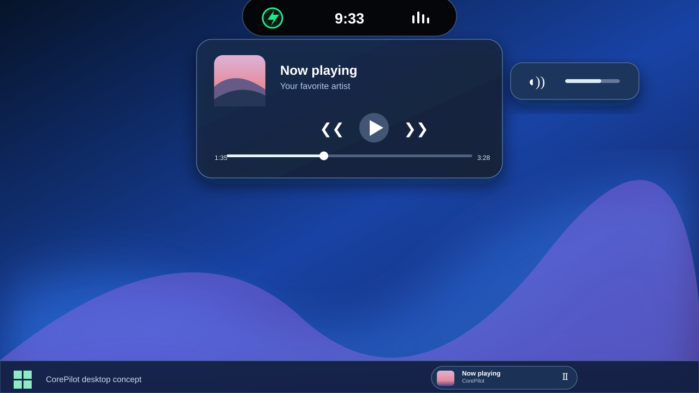

# CorePilot

### Celá plocha. Jeden elegantní ostrůvek.

**Hudba · Hlasitost · Schránka · Klávesy · Vlastní vzhled**

Moderní pomocník pro **Windows 10 a 11**, inspirovaný Dynamic Islandem.

[**Stáhnout CorePilot pro Windows**](https://github.com/CaseyCZ/CorePilot/releases/latest/download/CorePilot-Setup.exe) · [**Aktuální vydání**](https://github.com/CaseyCZ/CorePilot/releases/latest) · [**English**](README.md)

*Ukázka zamýšleného vzhledu. Některé detaily se mohou v nainstalované aplikaci lišit.*

## Méně rušení, více prostoru

CorePilot nenápadně sedí u horního okraje obrazovky. Kliknutím ostrůvek rozbalíš, ovládneš hudbu, otevřeš historii schránky nebo nastavíš vzhled. Pak se zase složí do malé lišty.

### Všechno po ruce

| | |
|---|---|
| 🎵 **Hudba** | Obal alba, název skladby, interpret, přehrát/pauza, předchozí/další a posun u podporovaných přehrávačů. |
| 🔊 **Hlasitost** | Změna hlasitosti, ztlumení a nenápadná indikace změny. |
| 📋 **Schránka** | Historie textů a obrázků, opětovné použití a rychlé vymazání. **Ve výchozím stavu vypnutá.** |
| ⌨️ **Caps Lock / Num Lock** | Přehledné upozornění při změně stavu kláves. |
| 🎧 **Mini přehrávač** | Volitelný malý přehrávač nad hlavním panelem Windows. |
| 🎨 **Vzhled** | Světlý a tmavý režim, animace a možnost vypnout nepotřebné funkce. |

## Jak začít

1. [**Stáhni CorePilot-Setup.exe**](https://github.com/CaseyCZ/CorePilot/releases/latest/download/CorePilot-Setup.exe).
2. Spusť instalační soubor a projdi průvodce.
3. Otevři **CorePilot** z nabídky Start.
4. Klikni na ostrůvek nahoře. Aplikaci najdeš také u hodin v oznamovací oblasti.

**Nemusíš instalovat .NET ani rozbalovat ZIP.** Instalační soubor obsahuje vše potřebné.

**Kompatibilita:** Windows 10 od verze 2004 a Windows 11, 64bitový procesor.

> **Upozornění Windows:** Instalační soubor zatím není digitálně podepsaný. Windows SmartScreen proto může zobrazit varování. Stahuj pouze z oficiálního vydání na GitHubu.

## Soukromí

Historie schránky je **dobrovolná a vypnutá**, dokud ji sám nezapneš. Obsah schránky zůstává pouze v paměti CorePilotu a při vypnutí funkce nebo ukončení aplikace se smaže. Nic se neposílá na server. Nastavení se ukládá jen na tvém počítači.

Na sdíleném počítači nebo při práci s hesly je bezpečnější historii schránky nepoužívat.

## Co je dobré vědět

- Ovládání hudby a posun skladby závisí na podpoře konkrétního přehrávače.
- Mini přehrávač se zobrazuje **nad hlavním panelem**, ne přímo uvnitř.
- Windows může vedle CorePilotu zobrazit také svoje systémové okno hlasitosti.
- Obrázek je návrh vzhledu. Některé efekty se mohou lišit podle Windows.
- Aplikace je určená pro Windows 10/11 x64.

## Nápady a pomoc

Našel jsi chybu nebo chceš něco doplnit? [Napiš nám na GitHub Issues](https://github.com/CaseyCZ/CorePilot/issues).

CorePilot je zdarma a s otevřeným zdrojovým kódem pod [licencí MIT](LICENSE).

**CorePilot — Méně zmatku. Více kontroly.**

[**Stáhnout CorePilot**](https://github.com/CaseyCZ/CorePilot/releases/latest/download/CorePilot-Setup.exe)

