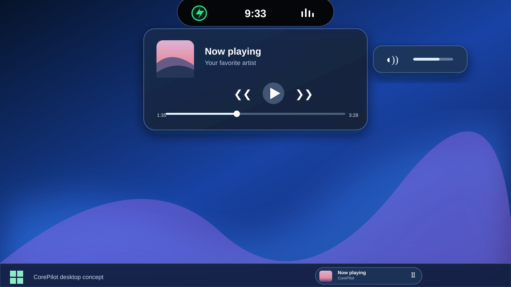

# CorePilot

### Your desktop. One beautiful island.

**Music · Volume · Clipboard · Lock keys · Your style**

A lightweight desktop companion inspired by Dynamic Island, designed for **Windows 10 & 11**.

[**Download CorePilot for Windows**](https://github.com/CaseyCZ/CorePilot/releases/latest/download/CorePilot-Setup.exe) · [**What's new**](https://github.com/CaseyCZ/CorePilot/releases/latest) · [**Čeština**](README.cs.md)

*Preview of the design. Some visual details may differ in the installed application.*

## Make room for what matters

CorePilot lives discreetly at the top of your desktop. Click the island to reveal your music, clipboard and preferences. When you're done, it folds back into a small, unobtrusive bar.

### Everything you need, right where you need it

| | |
|---|---|
| 🎵 **Now Playing** | See album artwork, song and artist. Play, pause, skip tracks and seek in supported media apps. |
| 🔊 **Volume** | Adjust the system volume, mute sound and get a subtle volume change indicator. |
| 📋 **Clipboard history** | Save recent text and images locally, reuse them in a click or clear everything. **Off by default.** |
| ⌨️ **Lock keys** | Know instantly when Caps Lock or Num Lock changes. |
| 🎧 **Mini player** | Keep a compact player floating just above the Windows taskbar. Turn it off whenever you like. |
| 🎨 **Personalize** | Choose light or dark appearance, enable or disable animations and customize individual features. |

## Beautifully simple

**One click.** Open or close your island.

**One place.** Music, clipboard and settings share a calm, familiar interface.

**Your choice.** Disable features you don't use. The mini player only appears when a media session is available.

**Made for Windows.** Runs on **Windows 10 (version 2004 or newer)** and **Windows 11**, on 64-bit PCs.

## Get started

1. [**Download CorePilot-Setup.exe**](https://github.com/CaseyCZ/CorePilot/releases/latest/download/CorePilot-Setup.exe).
2. Run the installer and follow the setup wizard.
3. Open **CorePilot** from the Start menu. Look for the small island at the top of the screen.
4. Click the island to open music, clipboard or settings. You can also access CorePilot from the system tray.

**No separate .NET installation required.** The Windows installer includes everything needed to run CorePilot.

> **Windows security notice:** The installer is currently not digitally signed. Windows SmartScreen may show a warning. Only download it from the official GitHub release, and check that the publisher and repository are the ones you expect.

## Your privacy comes first

Clipboard history is optional and **disabled by default**. When you turn it on, copied text and pictures stay in the application's memory and are cleared when CorePilot closes or you disable the feature. Nothing is uploaded to a server. Your local settings are saved on your computer.

Avoid enabling clipboard history on shared PCs or while handling passwords and other sensitive information.

## Good to know

- Playback controls and seeking depend on what your music or video app supports.
- The optional mini player **floats above** the taskbar; it is not embedded inside Windows' taskbar.
- Windows may still display its built-in volume indicator alongside CorePilot.
- The preview image represents the intended design; system effects and appearance can vary between Windows 10 and 11.
- The download supports **Windows x64**. It is not a Mac or Linux application.

## Say hello

Have an idea or found a problem? [Tell us on GitHub Issues](https://github.com/CaseyCZ/CorePilot/issues).

CorePilot is free and open source under the [MIT license](LICENSE).

**CorePilot — Less clutter. More control.**

[**Get CorePilot**](https://github.com/CaseyCZ/CorePilot/releases/latest/download/CorePilot-Setup.exe)

